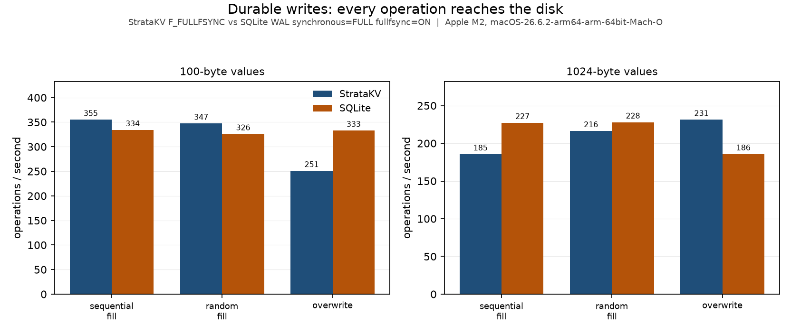
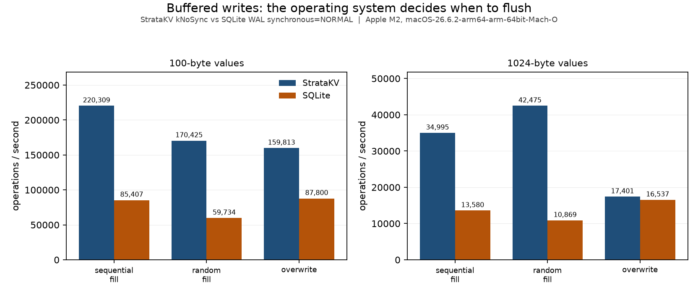
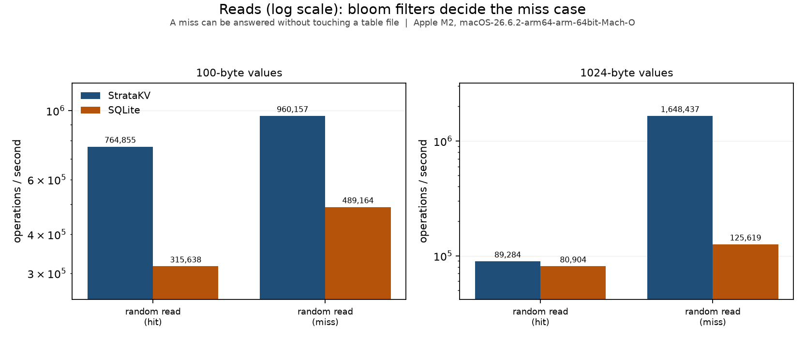
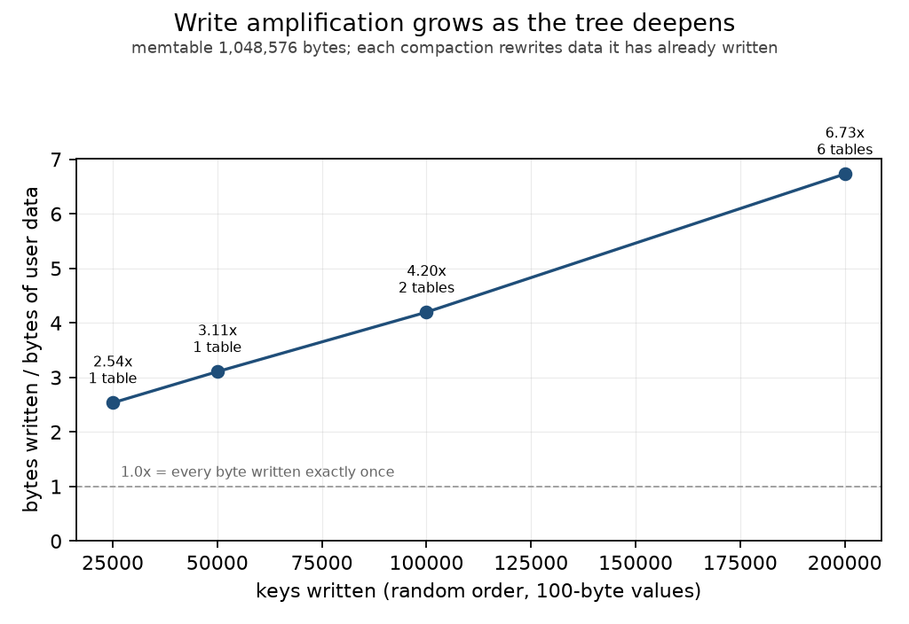

# StrataKV

An embedded key-value storage engine built on a log-structured merge tree (LSM tree).
C++20 engine, Python package, crash fuzzer, and benchmarks against SQLite. In one
sentence: a tiny RocksDB — you `put`, `get`, and `delete` keys, every acknowledged write
survives `kill -9`, and reads stay fast as data grows past memory.

> **Status: complete, P0 through P6.** Every acknowledged write reaches a checksummed
> write-ahead log and is flushed to the physical medium before `Put` returns. Full
> memtables flush to immutable SSTables on a background thread; compaction merges L0 into
> L1, reclaiming space from overwrites and deletes; a MANIFEST records the file set and
> reference-counted version snapshots keep files alive under running reads. Leader-follower
> group commit shares one `fsync` across queued writers, measured **4.74× faster** at 8
> writers. The crash fuzzer has verified **40,851 acknowledged writes across 1,000 SIGKILL
> crashes with zero lost**. Every number here comes from [docs/NUMBERS.md](docs/NUMBERS.md),
> with the command that produced it.

## Quick start

```bash
pip install .
```

```python
import stratakv

with stratakv.DB.open("/tmp/mydb") as db:
    db.put(b"apple", b"red")
    print(db.get(b"apple"))        # b'red'
    print(db.get(b"missing"))      # None

    db[b"banana"] = b"yellow"      # mapping syntax
    print(b"banana" in db)         # True
    del db[b"banana"]

    db.write_batch([                # atomic: all of it replays, or none
        (b"cherry", b"dark"),       # (key, value)
        (b"apple", None),           # a value of None deletes
    ])
```

By default `sync=True`: `put` does not return until the write is on the medium. That is
the slow, honest setting. `stratakv.DB.open(path, sync=False)` is measured 196–491× faster
depending on value size, and gives up the central guarantee.

## Architecture

Writes go to a write-ahead log first, then into memory; memory is periodically flushed to
immutable sorted files on disk; a background thread merges those files. Reads check the
newest data first and stop at the first match.

```
Put(k, v) ──> WAL append ──> fsync ──> memtable insert ──> acknowledge
                                           │
                        (4 MB) ────────────┘
                           │
                           v
                   immutable memtable ──flush──> L0 SSTable
                                                    │
                                   (4 files) ──compact──> L1 SSTables
```

Reads walk: active memtable → immutable memtable → L0 files newest to oldest → the one L1
file whose key range covers the key. Each SSTable checks its bloom filter before touching
disk, which is why a miss is so much cheaper than a hit.

The ordering trick that makes it work: keys are stored as
`user_key | sequence(7 bytes) | type(1 byte)`, with the user key ascending and the trailer
**descending**, so the newest version of a key sorts first and a lookup can stop at the
first match it finds.

| Piece | Where | What it does |
| --- | --- | --- |
| `Status` | [include/stratakv/status.h](include/stratakv/status.h) | Error returns instead of exceptions: `Ok`, `NotFound`, `Corruption`, `IOError`, `InvalidArgument` |
| `Env` | [src/env.h](src/env.h) | Every syscall the engine makes: append, `fsync`, rename, directory `fsync`, `flock` |
| `crc32c` | [src/crc32c.h](src/crc32c.h) | Hand-written CRC32C, compile-time table, no dependency |
| `DB` | [include/stratakv/db.h](include/stratakv/db.h) | `Open`, `Put`, `Get`, `Delete`, `Write(batch)`, `Close`, with a `LOCK` file so two processes cannot open one database |
| `WriteBatch` | [include/stratakv/write_batch.h](include/stratakv/write_batch.h) | A group of writes that becomes one WAL record with one checksum, so it replays entirely or not at all |
| WAL | [src/wal_writer.h](src/wal_writer.h), [src/wal_reader.h](src/wal_reader.h) | Checksummed records; a torn tail is truncated, mid-file damage is reported as `Corruption` |
| Memtable | [src/memtable.h](src/memtable.h), [src/skiplist.h](src/skiplist.h) | Skip list with one writer and any number of lock-free readers |
| SSTables | [src/sstable_builder.h](src/sstable_builder.h), [src/sstable_reader.h](src/sstable_reader.h) | Sorted immutable files: data blocks each with their own CRC32C, bloom filter, index, checksummed footer |
| Bloom filters | [src/bloom.h](src/bloom.h) | 10 bits/key, 7 probes, **measured 0.729%** false-positive rate |
| MANIFEST + versions | [src/version.h](src/version.h) | Append-only log of version edits, atomic `CURRENT` replacement, reference-counted snapshots |
| Compaction | [src/compaction.h](src/compaction.h) | L0→L1 k-way merge; drops shadowed versions and tombstones, **1.445×** space amplification measured |
| Group commit | [src/db_impl.h](src/db_impl.h) | Leader merges queued batches into one record with one shared `fsync`: **4.74×** at 8 writers, TSan-clean over a 60 s 8×8 stress |
| Crash points | [src/crash_point.h](src/crash_point.h) | `STRATAKV_CRASH_AT=<name>` kills the process at a named moment in the write or flush path |
| Python package | [python/stratakv/\_\_init\_\_.py](python/stratakv/__init__.py) | `DB` with mapping syntax and a context manager; releases the GIL during engine calls |
| Crash fuzzer | [tests/py/crash_fuzz.py](tests/py/crash_fuzz.py) | `SIGKILL`s a writing process at random moments, then demands every acknowledged write back |

## Crash safety

The engine's one central claim: **if `Put` returned OK, that write survives a crash.**

- A write reaches the write-ahead log and is flushed *before* it is acknowledged.
  Everything after that — memtable rotation, flush, compaction — happens in the background.
- On macOS, `fsync` alone does not flush the drive's own write cache, so `Env::Sync` uses
  `fcntl(fd, F_FULLFSYNC)`. See [src/env.cc](src/env.cc). This is the single most commonly
  missed detail in "durable" storage code, and it is why the SQLite comparison below sets
  `PRAGMA fullfsync=ON`.
- A torn record at the tail of the WAL is normal after a crash and is never an error: it
  was never acknowledged. Recovery truncates it.
- A failed `fsync` is treated as permanent rather than retried, because on Linux a retry
  can report success after the kernel has already discarded the data (*fsyncgate*).
- Every SSTable data block carries its own CRC32C, verified on read, so disk corruption
  inside a block is reported rather than returned as a value.

### How that is proven

| Evidence | Result |
| --- | --- |
| Crash fuzzer, 1,000 iterations of `SIGKILL` mid-write | **40,851 acknowledged writes, 0 lost, 0 corruption** |
| …of which named crash points | 445 iterations, all 7 points hit 127–168 times each |
| Hypothesis, engine vs. a reference `dict` over random sequences, with reopens | **1,050 sequences** against the current format, no divergence (10,500 before the block-checksum change) |
| 5,000,000 operations vs. a reference `std::map` | matched exactly across 360,035 keys |
| 60 s stress, 8 writers × 8 readers, ThreadSanitizer | 76,538 writes, 5,840,860 reads, **0 reports** |
| Every byte of an SSTable's data region damaged in turn | no damaged byte ever yields a wrong value reported as correct |
| C++ test suite under 4 presets (debug, release, ASan+UBSan, TSan) | 234 tests, all passing under all 4 |

"Acknowledged" is defined operationally rather than asserted: the fuzzer's child process
prints a key only *after* its `put` returns, so the printed set is exactly the set of
promises the engine made, and the parent demands all of them back after the kill.

## Benchmarks

Against SQLite in WAL mode — its fastest durable configuration — at **matched durability**,
identical keys, identical values, identical operation counts, from the same seed. Run on
Apple M2 (8 cores), macOS-26.6.2-arm64-arm-64bit-Mach-O, SQLite 3.50.4, Python 3.14.3,
at load average 2.91 before the run and 3.14 after. The suite refuses to start on a busy
machine, because an earlier run that did not check measured the same workload 3.4× slower
and nothing in its output said why.

Reproduce everything below, from a fresh clone, with one command:

```bash
./bench/run.sh
```

### Durable: every operation reaches the medium

StrataKV `sync=True` (`F_FULLFSYNC`) vs SQLite `synchronous=FULL, fullfsync=ON`.

**100-byte values**

| Workload | Ops | StrataKV | SQLite | StrataKV / SQLite |
| --- | --- | --- | --- | --- |
| Sequential fill | 2,000 | **355** | 334 | 1.06x |
| Random fill | 2,000 | **347** | 326 | 1.07x |
| Overwrite | 2,000 | 251 | 333 | 0.75x |
| Random read (hit) | 20,000 | **764,855** | 315,638 | 2.42x |
| Random read (miss) | 20,000 | **960,157** | 489,164 | 1.96x |

**1024-byte values**

| Workload | Ops | StrataKV | SQLite | StrataKV / SQLite |
| --- | --- | --- | --- | --- |
| Sequential fill | 2,000 | 185 | 227 | 0.82x |
| Random fill | 2,000 | 216 | 228 | 0.95x |
| Overwrite | 2,000 | **231** | 186 | 1.25x |
| Random read (hit) | 20,000 | **89,284** | 80,904 | 1.10x |
| Random read (miss) | 20,000 | **1,648,437** | 125,619 | 13.12x |



### Buffered: the operating system decides when to flush

StrataKV `sync=False` vs SQLite `synchronous=NORMAL`.

**100-byte values**

| Workload | Ops | StrataKV | SQLite | StrataKV / SQLite |
| --- | --- | --- | --- | --- |
| Sequential fill | 20,000 | **220,309** | 85,407 | 2.58x |
| Random fill | 20,000 | **170,425** | 59,734 | 2.85x |
| Overwrite | 20,000 | **159,813** | 87,800 | 1.82x |
| Random read (hit) | 20,000 | **1,244,084** | 281,508 | 4.42x |
| Random read (miss) | 20,000 | **2,449,380** | 572,740 | 4.28x |

**1024-byte values**

| Workload | Ops | StrataKV | SQLite | StrataKV / SQLite |
| --- | --- | --- | --- | --- |
| Sequential fill | 20,000 | **34,995** | 13,580 | 2.58x |
| Random fill | 20,000 | **42,475** | 10,869 | 3.91x |
| Overwrite | 20,000 | **17,401** | 16,537 | 1.05x |
| Random read (hit) | 20,000 | **91,975** | 74,588 | 1.23x |
| Random read (miss) | 20,000 | **1,684,157** | 114,118 | 14.76x |





### Write amplification

Bytes the engine really wrote, divided by bytes of user data. Random key order, 100-byte
values, 1 MB memtable — small enough that these key counts force repeated compaction.

| Keys | User data | Bytes written | Write amplification | SSTables on disk |
| --- | --- | --- | --- | --- |
| 25,000 | 2.85 MB | 7.22 MB | **2.54x** | 1 |
| 50,000 | 5.70 MB | 17.71 MB | **3.11x** | 1 |
| 100,000 | 11.40 MB | 47.85 MB | **4.20x** | 2 |
| 200,000 | 22.80 MB | 153.45 MB | **6.73x** | 6 |



**That curve rising is the point, not a defect.** Writing 200,000 keys means writing 22.8 MB
of user data and 153 MB to disk. Compaction's entire job is rewriting data it has already
written, so the more times a record is swept into a merge, the further the ratio climbs.
That is the trade an LSM makes: appends are cheap, and the cost is paid later, repeatedly,
by the compactor.

It climbs this steeply because StrataKV has **only two levels**. Every L0→L1 compaction
rewrites the whole of L1, so L1 is written again from scratch each time it is touched, and
the cost grows with the amount of data already in it. A real engine has five or more
levels precisely to bound this — each level is a fixed multiple of the one above, so a
record is rewritten a fixed number of times rather than a growing one. The two-level design
is listed under [known limitations](#known-limitations), and this is the number that shows
what it costs.

Note also that this measurement had to be built specifically. An earlier version reported
**1.02x**, which is not a good result for an LSM but an impossible one — it was measuring a
workload too small to ever fill a memtable, so nothing flushed, nothing compacted, and the
figure was the write-ahead log alone. Every row in the throughput tables above now also
records how many SSTables existed when it finished, so a run that never flushed says so
instead of quietly reporting 1.02x as though it meant something.

### What these numbers say

- **Read misses scale the way the structure predicts** — 1.96x ahead at 100 B, **13.1x at
  1 KB**. A bloom filter rejects a missing key from an in-memory bit array in constant time
  no matter how large the rows are, while a B-tree's descent gets more expensive as fewer
  rows fit per page. The gap widening tenfold between the two value sizes is the clearest
  structural result here, and it is the bloom filters doing it.
- **Buffered writes are 1.8x–3.9x ahead**, which is the LSM's design showing: a write is an
  append to a log and an insert into memory, with no page to locate and rewrite.
- **Durability costs 196x–491x** depending on value size. That gap is the disk, not the
  software, which is exactly why group commit matters — it changes *how many* flushes
  happen, which is the only lever software has once `fsync` is on the critical path.
- **SQLite is ahead on 3 of the 20 comparisons**, all of them durable single-key writes:
  sequential fill at 1 KB (1.23x), random fill at 1 KB (1.05x), and overwrite at 100 B
  (1.33x). When every operation waits for `F_FULLFSYNC`, both engines are mostly measuring
  the same disk, and a B-tree writing one page can beat a log plus a memtable insert. Those
  rows stay in this table. A benchmark that reports only the workloads you win is marketing.

### Four benchmark bugs, every one of them flattering

Most of the work in this phase was not writing the benchmark but distrusting it. Each of
these produced a believable number:

| Bug | Effect |
| --- | --- |
| SQLite not using `F_FULLFSYNC` on macOS | **6x** of the durable-write gap was fake. SQLite reported 305,227 "durable" writes/sec — three microseconds each, which no SSD can do |
| Overwriting a key with the *same* bytes | **395x**. A B-tree skips an unchanged page; an LSM appends regardless. That measures no-op detection, not overwrite cost |
| No page-cache warming | **~3x** to whichever engine ran second |
| A loaded machine | **3.4x** swing on one workload, with nothing in the output to say why |

Every one was caught by asking whether a number was physically possible, not by a test
failing. Nothing fails in a broken benchmark — the number simply appears, and looks like a
result.

## Building

Requires CMake 3.24+, a C++20 compiler (GCC 12+ or Clang 15+), and Ninja.

```bash
cmake --preset debug && cmake --build --preset debug && ctest --preset debug
```

Four presets are defined. Correctness is checked under all of them, not just `debug`:

| Preset | What it is for |
| --- | --- |
| `debug` | Symbols, no optimization — the default for development |
| `release` | Optimized; the only preset benchmarks may be run under |
| `asan` | AddressSanitizer + UndefinedBehaviorSanitizer — memory errors and UB |
| `tsan` | ThreadSanitizer — data races |

### Python package

```bash
pip install .
python -c "import stratakv; print(stratakv.version())"
```

`pip install .` runs CMake through scikit-build-core, compiles the extension, and places
it inside the `stratakv` package. Run the Python tests with `pip install '.[test]'` then
`pytest`.

### Formatting and linting

The linters are pinned in [requirements-lint.txt](requirements-lint.txt) so that a local
run and a CI run are the same check — clang-format versions disagree with each other about
real formatting decisions, so the version is fixed rather than the code contorted.

```bash
pip install -r requirements-lint.txt
find include src tests/cpp python \( -name '*.cc' -o -name '*.h' \) -print | xargs clang-format -i
./tools/run-clang-tidy.sh build/debug
ruff check python tests/py tools && ruff format python tests/py tools
```

## Design decisions worth defending

**One writer, many lock-free readers.** The skip list takes no lock on the read path. A
node is fully built before it is published with a single release store, and readers reach
nodes only through acquire loads. Without that pairing a reader on another core could see
the pointer before the contents — a bug that may never appear on x86 and shows up on ARM.

**`shared_ptr` as a concurrency tool, not just memory management.** A reader holds a
`shared_ptr` to a `Version`, and compaction cannot delete a file any live version still
references. Reference counting *is* the reader-writer coordination; there is no lock
between a read and a compaction.

**Group commit trades latency for throughput.** A leader merges every queued batch into
one WAL record and one `fsync`. The rule that makes it safe is small and easy to get
wrong: a follower that asked for `sync` never gets a weaker guarantee than it asked for,
so the leader stops the group at the first batch that would weaken it.

**Errors are return values, not exceptions.** `Status` is `[[nodiscard]]`, so ignoring a
failed write is a compile warning rather than a silent loss.

**Crash points are compiled in, not injected.** `STRATAKV_CRASH_AT=<name>` kills the
process at a named moment. Random `SIGKILL` finds what you did not think of; named points
hit the windows you know are dangerous. Using both is the strongest answer to "how do you
know recovery works?"

## Known limitations

Honest ones, all of them documented rather than discovered later:

- **A damaged *final* WAL record is indistinguishable from a torn write.** Both look like a
  bad checksum at the tail, and recovery truncates. P3's MANIFEST makes this *detectable*
  in principle — it records what should exist — but that cross-check is not wired up.
- **A slow reader delays file reclamation without bound.** A `Version` held open keeps its
  files alive. There is no timeout and no forced release; a reader that never finishes
  means disk that is never reclaimed.
- **`rename` and `ReadAt` failure paths are untested.** The error handling exists and is
  the right shape, but no test forces those particular syscalls to fail.
- **Two levels only** (L0 and L1). Real engines have more, and write amplification would
  change with them.
- **No range scans.** `Get` only. The merging iterator that a scan needs already exists
  internally for compaction, but it is not exposed.

By design and not planned: networking, replication, transactions across keys beyond atomic
write batches, and Windows support.

## Documentation

- [docs/STUDY.md](docs/STUDY.md) — **start here to learn the codebase**: the phase-by-phase study path
- [docs/DESIGN.md](docs/DESIGN.md) — on-disk formats and the decisions behind them
- [docs/DEBRIEF.md](docs/DEBRIEF.md) — what each phase built, and what it cost
- [docs/NUMBERS.md](docs/NUMBERS.md) — every measured number, with the command that produced it
- [docs/learning/](docs/learning/) — per-phase walkthroughs of the real code
- [docs/CPP_NOTES.md](docs/CPP_NOTES.md), [docs/GLOSSARY.md](docs/GLOSSARY.md) — C++ features and terms as they come up
